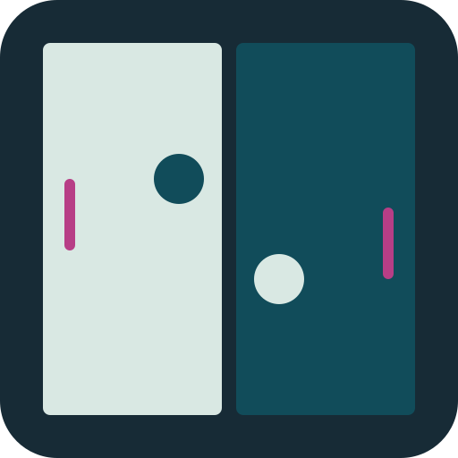

<p align="center">
  
</p>

<h1 align="center">Pong Wars Reloaded</h1>

<p align="center">
  <b>Day against Night. One board. Every square counts.</b><br>
  The eternal battle of Pong Wars, now with rackets, power-ups and computer opponents.<br>
  In your browser, on your phone, or on your TV.
</p>

<p align="center">
  <a href="https://mayerwin.github.io/pong-wars-reloaded/"><b>▶&nbsp;Play now</b></a>
  &nbsp;·&nbsp;
  <a href="#ways-to-play">Ways to play</a>
  &nbsp;·&nbsp;
  <a href="#play-on-a-tv">Play on a TV</a>
  &nbsp;·&nbsp;
  <a href="#how-to-play">How to play</a>
  &nbsp;·&nbsp;
  <a href="#power-ups">Power-ups</a>
</p>

---

https://github.com/user-attachments/assets/4446a03f-4b24-45d7-b49c-f2209feca44b

Pong Wars Reloaded is a full multiplayer evolution of [Pong Wars](https://github.com/vnglst/pong-wars), the eternal
battle between Day and Night. Balls bounce across the board and paint every square they touch in their team's
colour; now each side also has a racket to defend its land, steer the balls and catch power-ups. Written with
HTML5 Canvas, CSS and vanilla JavaScript, without any dependency.

## Features

- **Two players on one keyboard**, one against the computer, or two computer players to watch, with four
  difficulty levels (Easy, Medium, Hard, Hardest).
- **Rackets that turn:** snap them 45° at a time to send the balls where you want, and hit a ball while moving
  for a power shot.
- **Six power-ups** spawn as suns and stars: bigger and extra balls, a bigger racket, faster balls, a smaller
  enemy racket, and piercing balls that cut straight through enemy land.
- **Three ways to win:** dominate 80% of the board, lead when the clock runs out, or whichever comes first.
- **Emergency rescue:** three times per match, pull your nearest ball back to your racket.
- **Plays anywhere:** keyboard on a computer, an on-screen joystick on phones and tablets, and gamepads, the TV
  remote, keyboards or mice on Android TV and Google TV.
- **Three colour themes**, arcade menu music, sound cues, particles and screen shake, each with its own switch.

## Ways to play

| | Where | How to start | Controls |
|---|---|---|---|
| 💻 | **Computer**<br>Windows, macOS, Linux, ChromeOS | Open **[mayerwin.github.io/pong-wars-reloaded](https://mayerwin.github.io/pong-wars-reloaded/)** in any modern browser | Keyboard, two players |
| 📱 | **Phone or tablet**<br>Android, iPhone, iPad | Open the same address. *Add to Home screen* gives it an icon and the full screen | On-screen joystick and rotation buttons |
| 📺 | **TV**<br>Android TV, Google TV | The app, in a free beta on Google Play: [three steps](#play-on-a-tv) | Gamepads, TV remote, keyboard or mouse; one or two players |
| 🛠️ | **Your own copy** | Run `npx serve` in this folder ([Development](#development)) | Same as the website |

## How to play

### Objective

Each side starts with half the board. Balls bounce around and paint squares in their team's colour. Players use
rackets to deflect balls and control territory. The game ends by:

- **Domination**: a team controls 80% of the board
- **Time**: when the clock runs out, the team with more territory wins
- **Combined**: whichever happens first

From the main menu choose **2 Players**, **vs AI** or **AI vs AI** (with a difficulty per computer player), the
win condition, and the duration (click the timer label during setup for any value).

### Controls

| Action | Player 1 (Day) | Player 2 (Night) |
|---|---|---|
| Move up | <kbd>E</kbd> | <kbd>↑</kbd> |
| Move down | <kbd>D</kbd> | <kbd>↓</kbd> |
| Move left | <kbd>S</kbd> | <kbd>←</kbd> |
| Move right | <kbd>F</kbd> | <kbd>→</kbd> |
| Rotate left | <kbd>A</kbd> | <kbd>,</kbd> |
| Rotate right | <kbd>Q</kbd> | <kbd>.</kbd> |

**Pause** with <kbd>Esc</kbd> or the pause button in the HUD; the HUD also has a fullscreen button. Every key can
be changed in **Settings > Configure Keys**. On phones and tablets, side-panel joysticks come with rotation
buttons.

- **Rotation:** a press snaps the racket 45 degrees; holding keeps snapping every few frames; both rotate
  buttons together set it back to vertical.
- **Emergency rescue:** hold **both rotation keys** for 2 seconds to teleport your nearest ball to your racket.
  It clears a small area of enemy territory around the spawn point and resets the ball to normal size. Each
  player gets **3 rescues per game**, shown as dimmed icons in the HUD that brighten while charging.
- **Power shot:** moving your racket into a ball as it bounces off transfers momentum: the faster you move, the
  faster the ball goes, up to 30% above base speed. The boost fades over 5 seconds.

## Power-ups

Power-ups spawn as **stars** (Night territory) or **suns** (Day territory) every 15 seconds (configurable), and
expire after 30 seconds. Walk your racket over one to collect it.

| Power-up | Icon | Effect |
|---|---|---|
| Big Ball | ◉ | Ball radius +100% of base per stack (max 5 stacks) |
| Extra Ball | ✚ | An additional ball for your team (max 8) |
| Big Racket | ⇕ | Your racket grows by 2 blocks per stack (max 3 stacks) |
| Fast Ball | » | Ball speed +50% of base per stack (max 4 stacks) |
| Shrink Foe | ⤓ | The opponent's racket shrinks by 2 blocks per stack (max 3 stacks, min 3 blocks) |
| Pierce Ball | ⇥ | All your balls move at half speed for 6 seconds, ignoring Fast Ball boosts, and capture territory without bouncing; only walls and rackets deflect them |

- Effects stack up to the maximum of each type; collecting beyond the cap replaces the oldest, extending its
  duration. Extra balls cap at 8 per team; more pickups extend the oldest ball's duration.
- Pierce Ball and its slowdown always last **6 seconds**, extra balls included, whatever the duration setting.
  Another pickup refreshes both to 6 seconds without stacking. Fast Ball boosts are ignored meanwhile and resume
  afterwards if they have not expired. A ring marks the affected balls, which also pass through other balls.
- Active power-ups show in the HUD next to each team's score, with stack counts.

## Settings

Open the settings with the **gear icon** (⚙) during a game, or from the main menu or the pause screen. They are
saved in the browser, each with its own reset button. Game rules (power-ups, free movement) are greyed out during
a game.

| | |
|---|---|
| **Sound** | Master switch and volume; **menu music** (looping arcade music in menus, remembered separately); short cues for menu navigation and match start, which fade the music without delaying play; **touch vibration** where the browser supports it |
| **Visual effects** | Master switch; **colour theme** (Coral, Sunset or Cyber); **screen shake** (tiny nudges on racket hits and pickups, independent of the device's reduced-motion setting); racket outline; grid lines (off by default); particles; progress bar |
| **Power-ups** | **Frequency** (5 to 60 seconds); **duration** (10 to 120 seconds, except Pierce Ball's fixed 6 seconds); **mirrored types** (both teams get the same sequence, off by default) |
| **Gameplay** | **Free movement**: rackets may cross enemy territory and collect power-ups on either side (off by default: enemy squares block rackets) |

<details>
<summary><b>HUD, win screen and physics details</b></summary>

### HUD

- **Score**: territory count per team
- **Timer**: remaining game time (click to enter any duration)
- **Power-up icons**: active effects with stack counts
- **Rescue charges**: dimmed ⇌ icons with the remaining count
- **Progress bar** (below the HUD): domination progress, scaled so that 100% means the 80% domination threshold

### Win screen

- **Domination win**: "DAY/NIGHT DOMINATES!"
- **Time-based win**: "DAY/NIGHT WINS!" with the domination percentage (for example "59% domination")
- **Draw** (both at 50%): "IT'S A DRAW!"

### Physics

- Sub-stepped movement keeps fast balls from passing through rackets
- Elastic ball-ball collisions keep balls from overlapping, except while Pierce Ball is active
- Balls pass through squares protected by the opponent's racket (no stuck oscillation)
- A racket completely trapped by enemy territory gets the adjacent enemy squares cleared, so it can never be stuck
  for good

</details>

## Play on a TV

Pong Wars Reloaded for **Android TV and Google TV** (Google TV Streamer, Chromecast with Google TV, TVs with
Google TV built in) is in a free beta on Google Play, solo or with two players, with gamepads, the TV remote,
keyboards or mice.

1. **Join the tester group.** On a phone or a computer, signed in with the Google account of your TV, open
   the [tester group](https://groups.google.com/g/erwin-mayer-labs-beta/about) and choose **Join group**.
2. **Become a tester.** With the same account, open
   [play.google.com/apps/testing/com.github.pongwarsreloaded](https://play.google.com/apps/testing/com.github.pongwarsreloaded)
   and choose **Become a tester**.
3. **Install it.** Find Pong Wars Reloaded in Google Play on your TV, or follow **Download test app** on the
   testing page and pick your TV as the device.

No developer options, no sideloading. Google can take a few hours to let a new tester in. Google Play only accepts
testers it knows, which is why there are two steps; to invite someone, send the group's page: it links every app
of the beta. [Report a problem](https://github.com/mayerwin/pong-wars-reloaded/issues).

| On the TV | Move | Rotate | Rescue | Pause |
|---|---|---|---|---|
| Gamepad | stick or d-pad | shoulders or triggers | hold X or Y | Start, Back or B |
| TV remote | arrows | tap OK to switch between moving and rotating | hold OK | Back |
| Mouse | move the mouse | scroll wheel | hold the left button | right button |

Each player joins by pressing a button on their device; a new device shows which buttons to use once, then
remembers them.

## Development

Run:

```sh
npx serve
```

Open up the link and you're ready to start.

Run the automated tests with `node --test tests/*.test.cjs android/tests/*.test.cjs`. Android build and release
instructions are in [android/README.md](android/README.md).

## Credits

Original Pong Wars by [Koen van Gilst](https://koenvangilst.nl). This fork by
[Erwin Mayer](https://github.com/mayerwin/pong-wars-reloaded).

Menu music: **Level 1** from *Retro Game Music Pack* by Juhani Junkala, released under
[CC0](https://opengameart.org/content/5-chiptunes-action). [Audio credits and license](assets/audio/LICENSE.txt).

I saw this first [here](https://twitter.com/nicolasdnl/status/1749715070928433161), but it appears to be a much
older idea. There's some more information on the history in the
[Hackernews discussion](https://news.ycombinator.com/item?id=39159418).

The colors are based on the Mindful Palette by
[Alex Cristache](https://twitter.com/AlexCristache/status/1738610343499157872).

## Alternate versions

If you've created an alternate version of Pong Wars and would like to share it, please feel free to create a pull request to add the link here.

<details>
<summary>38 alternate versions, in alphabetical order</summary>

- [ASCII Python](https://github.com/flash1293/ascii-pong-wars)
- [Atari 2600](https://forums.atariage.com/topic/360475-pong-wars-atari-2600)
- [BBC Micro Bot](https://mastodon.me.uk/@bbcmicrobot/111829277042377169)
- [C version](https://github.com/BrunoLevy/TinyPrograms)
- [C# (Cross-platform on iOS, Android, WebAssembly, MacOS, Linux, and Windows)](https://aka.platform.uno/pongwars)
- [C# with DIKUArcade](https://github.com/Roar-Morkore-Hansen/pong-wars.git)
- [C++](https://invent.kde.org/carlschwan/pongwars/-/blob/master/src/scene.cpp?ref_type=heads)
- [C++ with SFML](https://github.com/Alan-Kuan/pong-wars)
- [Combat Pong](https://www.combatpong.com/)
- [Earlier version with padels](https://twitter.com/CasualEffects/status/1390290306206216196)
- [Eternal Bounce Battle (GDevelop)](https://gd.games/victrisgames/eternal-bounce-battle)
- [Flutter](https://github.com/flikkr/flutter_pong_wars)
- [Framework 16 LED Matrix](https://github.com/boobcactus/fw16-pongwars)
- [Godot](https://github.com/rosskarchner/pong-wars-godot)
- [Gold Wars (This version has an end!)](https://ask5.github.io/gold-wars/)
- [Java](https://github.com/krefikk/yingyang)
- [Kotlin/Wasm](https://github.com/wasmhub-dev/pong_wars.kt)
- [Land-Or-Water](https://github.com/makaveli2P/land-or-water)
- [Pico8](https://www.pico-8-edu.com/?c=AHB4YQHaAT3vsH558QbF5cXZxd3F_Uedc010zTVJ_gCnN3F6-RNE_SuEUXRRUa8tpK9wzE3nZMedcvntx9y1MpRnV4Xp0v3ZTrm0EUzMSQTsOWBuJL5-8C2Cl0gG0vK2sXTtKYyQN81iujMXPUN03Vq0FGXNajPzGtHOXUGgE3zegFI4hIIzoYCyC7ITgzcogmTuIaba7Nqzz48mh5JFxYFgKllpExWB7ZVnKAaH5qvd3SzqTLA0aZrR1Wy0GFywwsjUQhgOznQ3jtx6QCkisOCWvA9ngqFsZXMnFyKJhkynGFYEyZmCBcaIkk5BMF3YVRBX7RcFcZtGQbRQEN9GU_uMVEkSiRNn_aR55AmGqmBbiigfGuqybCXz5QnZI3W_Lutw2Ph4FOMn6Scn0lBgoSsFi3KlgIGpya1iYRY=&g=w-w-w-w1HQHw-w2Xw-w3Xw-w2HQH)
- [Pong-Wars Fireballs](https://pong-wars-fireballs.vercel.app)
- [Processing](https://github.com/riktov/processing-pong-wars)
- [Pygame version](https://github.com/BjoernSchilberg/py-pong-wars)
- [Python](https://github.com/vocdex/pong-wars-python)
- [Rock, Paper, Scissors, Lizard & Spock](https://kartikp36.github.io/rock-paper-scissors-lizard-spock/)
- [React Native](https://github.com/Nodonisko/react-native-skia-pong-wars)
- [Rust/Wasm](https://github.com/wasmhub-dev/pong_wars.rs)
- [Scratch](https://scratch.mit.edu/projects/957461584)
- [Seasons Pong](https://github.com/hmak-dev/seasons-pong)
- [SwiftUI (Native)](https://github.com/1998code/pong-wars-swiftui)
- [Swift (SpriteKit)](https://github.com/frederik-jacques/ios-pongwars)
- [Tag-Team](https://github.com/SSteve/pong-wars) ([Live](https://ssteve.github.io/pong-wars/))
- [Yin-Yang Pong](https://ying-yang-pong.vercel.app/)
- [Ying Yang](https://twitter.com/a__islam/status/1751485227787034863)
- [M5Stack version](https://github.com/anoken/pong-wars-forM5Stack/)
- [Hex version](https://pong-wars-hex.whichoneiwonder.com/)
- [Bevy](https://github.com/andyleclair/bevy_pong_wars)
- [Atari ST](https://github.com/neilrackett/atarist-pong-wars.git)
- [Three.js](https://labs.mesmotronic.com/three-labs/pong-wars-3d/)

</details>
